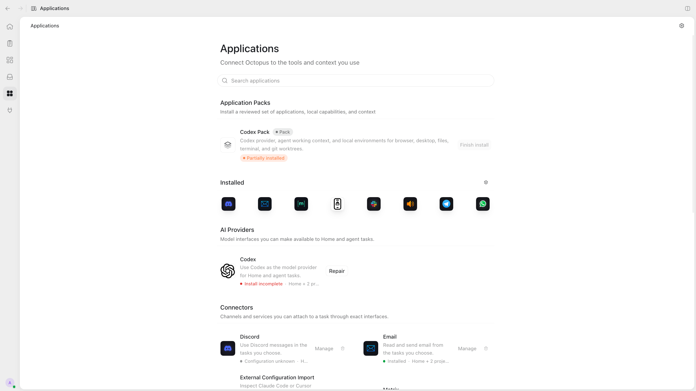

# Extending Octopus

The cookbook for adding capabilities without editing the runtime.

## It should work like a package

Adding an interface, a worker, a tool, a verifier, or a room should feel like
dropping in a portable bundle and editing a few JSON bindings. "Package" is a
distribution layout, **not a runtime primitive**. Once loaded, the runtime does
not reason about package identity. It sees ordinary descriptors, exact
interface folders, bindings, artifacts, policy, marks, rooms, and runs.

For an existing family, a new Telegram-like channel, provider, or worker preset
is descriptor and binding data. If adding one channel requires editing app
bootstrap, session logic, or a manager named after the concept, a primitive has
leaked.

If a genuinely new execution family is missing, add that family once as code
inside its owner folder. Every later instance of it is data.

## In the client

The optional desktop client's **Applications** catalog presents these packages
as providers, connectors, plugins, and context artifacts. A messaging connector,
for example, installs interface files; making it available in a Project and
binding it to a task are separate steps. Installation does not make the model
call it automatically. An application pack groups packages for setup without
introducing a new runtime identity.

[Drivers](ENVIRONMENTS.md#in-the-app) package worker-environment kinds.
[Client Extensions](../client.md#client-extensions) instead add widgets, tabs,
and guided repairs to the app. Use those when extending the presentation;
use the recipes below when extending what the runtime can do.

## What takes what

| You want | You add | Runtime code |
| --- | --- | --- |
| A provider over an existing wire (OpenAI-compatible, Anthropic-style, …) | One interface folder: `interface.json` + `life.json` importing the wire owner's driver, with its own transport config | None |
| A provider over a new wire | Driver code inside the interface folder that owns that wire, then the folder above | None |
| A channel, sensor, or service | One interface folder, with a process if it must listen | None |
| A worker | A copied `system_worker_<name>/` folder: new id, edited ceiling | None |
| A goal | An `ee_template` folder | None |
| A tool over an existing room binary | A `tool.json` with its `handler_config` | None |
| A tool with new behavior | A binary in the owning kind's packages + `tool.json` | None |
| A room over an existing executor family | A `worker_environment_kind` folder + a door interface | None |
| A genuinely new kind of room | Kind-owned package code first, then the descriptors | None |
| A check | A `verifier` folder: descriptor + script | None |
| An outcome | A `mark` folder, then allow it in a worker's ceiling | None |
| A role, grounding text, or skill | An `artifact` folder, then bind it on a checkpoint | None |
| System data kept on screen | A feed interface folder without a life, a run that emits into it, and a client Extension that reads the feed | None |

The last column is the point.

## Where code lives

Every executable file belongs to a concrete owner folder:

- `registry/interface/<id>/packages/` - an interface's folder name is its
  routing id;
- `registry/worker_environment_kind/<name>/packages/` - a kind's folder name is
  the name of an execution-code type; nothing routes by it.

There is no neutral shared code home between owners. An owner reuses another
owner's code by importing it explicitly from the owning folder. The import
creates no shared identity, no family admission, and no policy surface.

What is never shared is the live executable: each kind runs its own door and
executor processes. Byte-for-byte clones of code per owner are not the model
either. Import is.

## Add a provider

1. Copy the nearest provider folder that speaks your wire, for example
   `registry/interface/world_provider_ollama/`, to `world_provider_<name>/`.
2. Set `id` to the new folder name.
3. Edit `interface_driver_config`: base URL, model, request shape, and the
   *name* of the environment variable that holds the key. Never the key.
4. Keep `life.json` pointing at the wire owner's driver
   (`interface://<owner>/packages/...`), and list any environment names the
   process may inherit.
5. Add the new id to the `ceiling.interfaces` of the worker pins that may use
   it, and to any EE template that restricts `allowed_interfaces`.
6. Bind it on a run's checkpoints.

Nothing in the runtime changes, and nothing matches on the provider's name.

## Add a channel or sensor

1. Create `registry/interface/world_<function>/interface.json`. Name it for
   what it *is*, not for a brand convenience.
2. If it must listen, add `life.json` and the process. Any language: it reads
   its movements from the ledger or the SQLite index and hands artifacts back
   as JSON lines.
3. Decide what counts as heard. The interface is the threshold of
   artifact-space; filtering raw input is its job, not the kernel's.
4. Bind it on a run's checkpoint. Until something binds it, it does not run.

Start from `registry/interface/world_pyecho/` - a complete Python interface in
one file - and [registry/interface/GUIDE.md](../../registry/interface/GUIDE.md).

## Add a worker

1. Copy a `system_worker_<name>/` folder.
2. Change the id in both JSON files.
3. Edit the ceiling: the interfaces it may reach (providers, doors, other
   workers), its tools, its room kinds, the marks it may close.
4. List its `role_artifacts`, creating new artifact folders for the role text.
5. Allow the new pin wherever an EE template restricts `allowed_interfaces`.

Two JSON files. A tool that lives in a room must be reachable through one of
the pin's room kinds, and every mark id must exist, or loading fails closed.

## Add a tool

1. Find the room it belongs to. A tool belongs to exactly one kind.
2. If an existing binary of that kind can do it, write
   `registry/tool/<id>/tool.json` with a `handler_config` selecting the
   operation.
3. If not, add the binary to the kind's packages and declare it among the
   kind's owned tool binaries.
4. Declare only the authority the process needs. For a path that arrives in
   arguments, declare it as an argument path within specific root slots rather
   than granting the room.
5. Add the tool id to the ceilings of the workers that may hold it.

See [registry/tool/GUIDE.md](../../registry/tool/GUIDE.md).

## Add a check and an outcome

1. `registry/mark/<id>/mark.json` - the vocabulary entry.
2. `registry/verifier/<id>/` - `verifier.json` and a script that reads the
   request on stdin and prints `{"passed": …, "details": …}`.
3. Allow the mark in `ceiling.mark_outcomes` of the workers whose checkpoints
   may close it.
4. Reference both from a checkpoint's `required_verified_artifacts`.

Do not substitute verifiers for marks or the other way around. A blank check is
the explicit `artifact_exists` verifier, never a hidden pass.

See [registry/verifier/GUIDE.md](../../registry/verifier/GUIDE.md) and
[registry/mark/GUIDE.md](../../registry/mark/GUIDE.md).

## Add a room

1. If an existing executor family fits - process execution, browser, desktop,
   container, MCP - write a `worker_environment_kind` descriptor over it and a
   door interface whose driver belongs to that kind.
2. Declare the boundary ceiling in `boundary_defaults`. Policy can narrow it
   and nothing can widen it.
3. Declare new symbolic root slots, and bind them once in `host.json`.
4. If no family fits, write the executor as kind-owned package code first.

See [registry/worker_environment_kind/GUIDE.md](../../registry/worker_environment_kind/GUIDE.md).

## Time and inactivity triggers

The clock interface supports inactivity: selected runs' artifact movements
restart a declared quiet period, after which one artifact wakes an ordinary
run. Selection is a descriptor match, optionally narrowed to one EE subtree.
Its own target runs are excluded, a due period fires exactly once, and
admission evidence survives restart. Selection, timing and cursor state belong
to the interface package; the client projects these activations as Triggers.
A disabled activation that no run binds is a template, shipped by a package:
Triggers clones it, with private copies of its controller interfaces and
authoring tool, into a trigger bound to its own controller run.

## Media across interfaces

Carry files as artifact references, not filesystem path strings. A transport
adapter may materialize bytes however it needs; the framework surface stays
artifact-native.

## Who may change the registry

Authority is policy, and the mechanism is ordinary file tools. A run whose room
covers a registry path can write there; the write is a gated, recorded tool
call. A narrower run asks by emitting an artifact to a run that already holds
the authority.

## Before adding code

Ask:

- Is there a registry or descriptor layer where this behavior belongs instead
  of a branch?
- Does this add a branch on a worker's name, a provider's name, a model string,
  or an artifact label? Then stop.
- Does every new side effect leave an artifact and a movement?
- Is failing closed with a clear error better than a fallback that almost
  works? It usually is.
