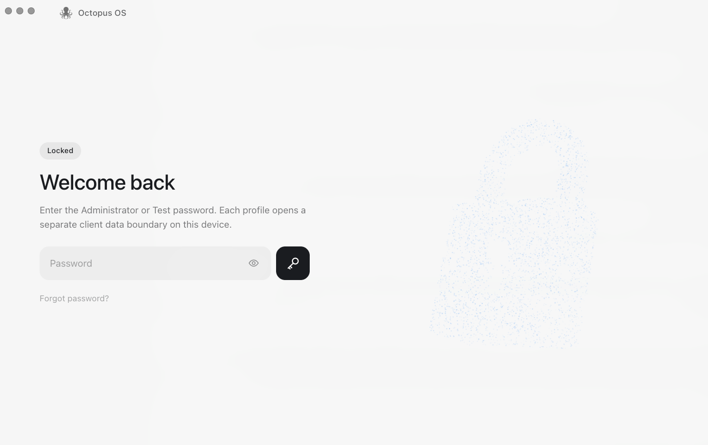

# Getting started

The research preview runs locally on macOS. You build the desktop app from this
repository and finish setup inside it. Codex is the first supported provider,
and sign-in is **Sign in with ChatGPT** in the app - no separate provider CLI login.

For the terminal client and its independent build command, see
[Terminal client](cli.md). Both clients use the same Home and runtime.

## Prerequisites

- macOS 14 or later, with the checkout on an APFS volume.
- Xcode Command Line Tools (`xcode-select --install`), including Clang, Swift,
  the macOS SDK, and `/usr/bin/python3`.
- [Node.js 24 LTS](https://nodejs.org/en/download) and npm. Node 20 does not
  support the required native rebuild and SQLite checks.
- Current stable [Rust](https://www.rust-lang.org/tools/install) and Cargo.
  The workspace and locked dependencies require at least Rust 1.91.
  Use current stable for the preview build.
- Internet access to fetch dependencies and the pinned provider distribution.
  A ChatGPT account with access to the selected model is needed for Home.

The packager builds for the architecture of the Node process running it. Use a
native Node installation on Apple Silicon. Intel packaging has a source path but
is not established as a tested preview distribution here.

## Build

```sh
git clone https://github.com/miuuyy/Octopus-SI-OS.git
cd Octopus-SI-OS
npm ci --prefix app
```

The native presentation build requires headers for Node **24.15.0**, independently
of the Node version running npm. Fetch the pinned headers from Node.js:

```sh
mkdir -p app/build
curl -fL https://nodejs.org/download/release/v24.15.0/node-v24.15.0-headers.tar.gz \
  -o app/build/node-v24.15.0-headers.tar.gz
printf '%s  %s\n' \
  9a9250039fef572d0bcc110ac5e78055faf5604421211d2d5f578ebc5a34e703 \
  app/build/node-v24.15.0-headers.tar.gz | shasum -a 256 -c -
tar -xzf app/build/node-v24.15.0-headers.tar.gz -C app/build
```

The checksum is from the [Node.js release manifest](https://nodejs.org/download/release/v24.15.0/SHASUMS256.txt).
Then package and open the app:

```sh
OCTOPUS_NATIVE_NODE_HEADERS="$PWD/app/build/node-v24.15.0/include/node" \
  npm --prefix app run package:mac
open -n ./app/build/Octopus.app
```

Packaging builds the renderer, release runtime, capability executables, and
provider bridge; it includes the managed Codex distribution and verifies an
ad-hoc code signature. The output is `app/build/Octopus.app`, built for this
machine. It is not a notarized installer or a universal binary. Repackaging
replaces that bundle in place.

## First setup

Follow the client screens. The actions depend on the setup already present on
your machine:

- **Sign in with ChatGPT** opens browser authentication. Complete it in the
  browser and return to the client.
- The access screen lets you configure or enter the local administrator password.
- The embedded launch terminal prepares a command ending in `octopus up`.
  Press Enter to run it and wait for the runtime's ready state.
- Workspace setup asks for a starting structure, project names, and capabilities.
  Review the choices and select **Set up Octopus**.



The local access password is separate from provider sign-in. Later,
**avatar → Log out** returns to this gate without removing your Home or
provider credentials.

When the client reaches Home, send a short message. A model reply checks the
connection; exercising a task's granted tools checks that task's capability setup.

For a new task, use **Create agent** if the Agent list is empty. Choose a Project
and an offered model, review capabilities, and create the Agent. Then choose its
Project and select the Agent in the task composer.

The [desktop client guide](client.md) explains Home, Tasks, voice, gestures,
and how Applications and Drivers become available to a project.

The packager supplies the provider executable. A separate terminal login is not
part of this onboarding flow. Model availability and usage limits belong to the
provider account. Additional applications and voice capabilities can require
their own credentials and macOS permissions.

## Local data and diagnostics

By default, the app uses `~/.octopus` as its Octopus Home. The active registry,
run and EE records, ledger, interface state, and client setup data live there.
Provider sign-in uses the machine's Codex authentication boundary, normally
under `~/.codex`; authentication is not contained entirely in the Octopus Home.
Treat both locations as private.

For a separate preview Home, launch the executable directly so it receives the
environment variable:

```sh
OCTOPUS_HOME="$HOME/.octopus-preview" \
  ./app/build/Octopus.app/Contents/MacOS/Octopus
```

Keep the Home path short: macOS Unix sockets have a path-length limit. This
separates Octopus state, but does not create a separate provider account.

From the checkout root, inspect the selected default Home without booting:

```sh
./app/build/Octopus.app/Contents/Resources/app/bin/octopus doctor
```

For a custom Home, pass the same `OCTOPUS_HOME` to diagnostics. A healthy boot or
doctor report does not prove that every provider or tool works. If setup fails,
retain the displayed error and use the client's explicit retry/sign-in action;
do not reset the Home or replace its descriptors to make an error disappear.
